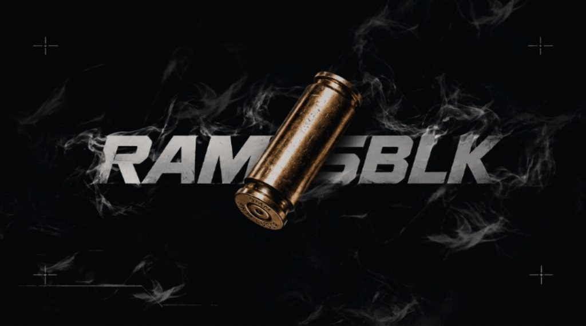

  

<h1 align="center">Pedro Ramos</h1>

Estudante de Ciência da Computação · Desenvolvimento Backend e APIs

## Sobre

Sou estudante do **6º período de Ciência da Computação**, com foco em **desenvolvimento backend e APIs**. Tenho forte interesse em **MySQL** e **arquitetura de software**.

Atualmente, busco uma **oportunidade de estágio em desenvolvimento de software** para aplicar meus conhecimentos e evoluir na área.

## Tecnologias

**Backend**

**Frontend / Web**

**Banco de Dados**

**Controle de Versão**

## Projeto em destaque

### [Hidden Way](https://github.com/ramosBlk/--Hidden-Way---)

Jogo 2D de plataforma e aventura desenvolvido com **Python** e **Pygame**. O projeto explora mecânicas de movimentação, plataformas, obstáculos e progressão por fases.
